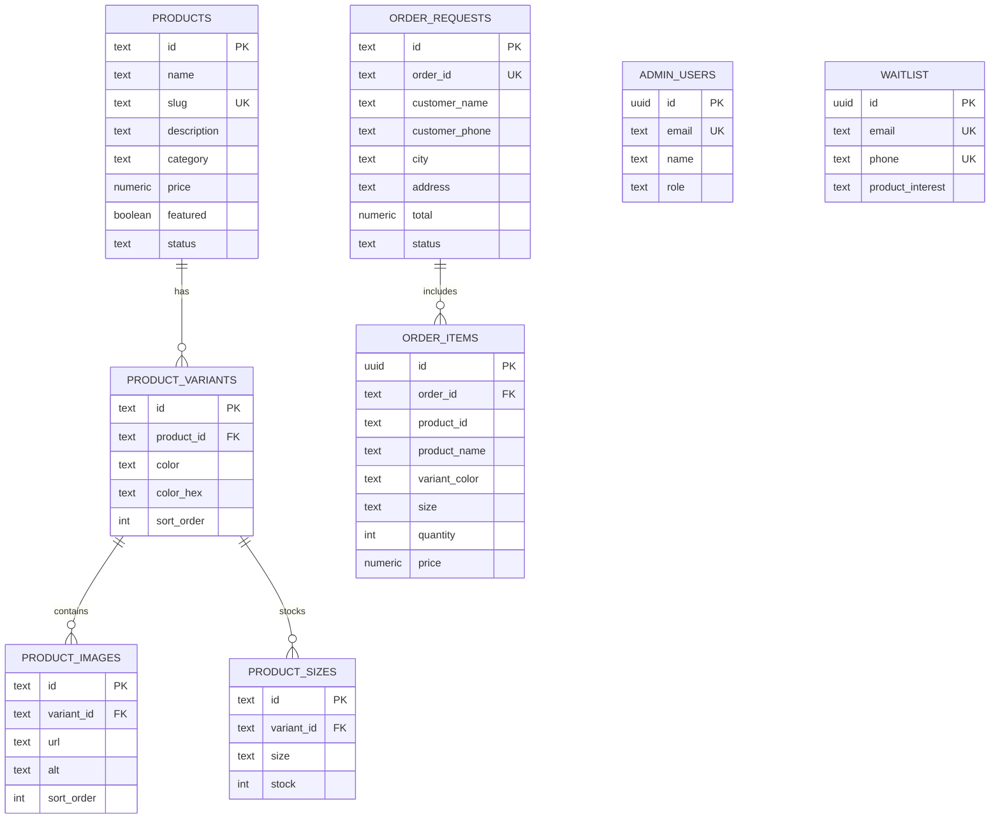

# KAPDE — Technical Architecture, Implementation & Repository Context

> **A Comprehensive Technical Context Document for Developers, Architects & AI Coding Agents**  
> *Target Use:* Complete engineering documentation detailing the technical foundation, architecture decisions, codebase structure, reference material integration, database schemas, and GitHub deployment guidelines.

---

## 🛠️ Technology Stack Breakdown

| Layer | Technology | Version | Purpose |
|---|---|---|---|
| **Framework** | Next.js (App Router + Turbopack) | `15.1.0` (Next 15.5.28 runtime) | Server Components, dynamic API routes, optimized static rendering |
| **Language** | TypeScript | `5.0.0` | Strict type safety across database entities, API payloads, and frontend state |
| **Runtime UI** | React & React DOM | `19.0.0` | Modern concurrent rendering, server actions, and client components |
| **Styling** | Vanilla CSS Tokens + Tailwind CSS | `4.0.0` | High-performance CSS custom properties, zero runtime style overhead |
| **Database** | PostgreSQL via Supabase | `@supabase/supabase-js 2.116.0` | Relational schema, foreign keys, cascading deletes, JSONB stored procedures |
| **State Store** | Zustand | `5.0.3` | Lightweight client-side cart & checkout state with LocalStorage persistence |
| **Icons** | Lucide React | `1.47.0` | Clean, minimalist monochrome iconography |
| **Validation** | Zod | `3.23.8` | Schema validation for checkout and admin API endpoints |
| **Drag & Drop** | `@dnd-kit/core` & `@dnd-kit/sortable` | `6.3.1` / `10.0.0` | Image reordering and variant sorting in Admin CMS |

---

## 📂 Repository File System Architecture

```
d:/Coding/Kapde/
├── app/
│   ├── about/                    # Dedicated Atelier & Philosophy brand story page
│   │   └── page.tsx
│   ├── admin/                    # Role-gated Atelier CMS
│   │   ├── auth/callback/        # OAuth callback handling
│   │   ├── dashboard/            # KPI stats, inventory health, recent orders
│   │   ├── login/                # Dual Google OAuth & master admin key login
│   │   ├── orders/               # WhatsApp order fulfillment & confirmation
│   │   ├── products/             # Product catalog grid & table
│   │   │   ├── [id]/             # Product edit screen with image reordering
│   │   │   └── new/              # Product creation interface
│   │   ├── waitlist/             # Priority drop roster subscriber table
│   │   ├── layout.tsx            # Admin navigation shell & session detector
│   │   └── page.tsx              # Automatic redirection to dashboard
│   ├── api/                      # Next.js Server-side Route Handlers
│   │   ├── admin/
│   │   │   ├── auth/             # Session verification & password authentication
│   │   │   ├── orders/           # Atomic order confirmation & cancellation
│   │   │   ├── products/         # Product CRUD & variant synchronization
│   │   │   ├── upload/           # Supabase Storage direct bucket asset upload
│   │   │   └── waitlist/         # Admin subscriber deletion & export
│   │   ├── checkout/             # Order creation & WhatsApp manifest generation
│   │   └── waitlist/             # Public drop roster registration
│   ├── privacy/                  # Customer data privacy policy
│   ├── products/
│   │   └── [slug]/               # Tri-column Aimé Leon Dore product detail view
│   ├── terms/                    # Store terms & conditions
│   ├── globals.css               # Aimé Leon Dore design tokens & component classes
│   ├── layout.tsx                # Root HTML layout, SEO meta tags, font configuration
│   ├── not-found.tsx             # Editorial 404 handler
│   ├── page.tsx                  # Home collection storefront server component
│   ├── robots.ts                 # Dynamic search engine crawler instructions
│   ├── sitemap.ts                # Dynamic XML sitemap generator with product slugs
│   └── StorefrontClient.tsx      # Interactive client orchestration layer
├── components/
│   ├── admin/                    # Admin CMS modular interface components
│   │   ├── AdminSidebar.tsx      # Collapsible dark admin navigation
│   │   ├── AuthHashDetector.tsx  # OAuth hash fragment detector for client tokens
│   │   ├── OrderTable.tsx        # Order filtering, status badges, atomic confirm
│   │   ├── ProductForm.tsx       # Comprehensive product, variant, image & size editor
│   │   ├── ProductTable.tsx      # Catalog management with status filtering
│   │   ├── StatCard.tsx          # Dashboard metric cards
│   │   ├── StatusBadge.tsx       # Standardized status tags
│   │   └── WaitlistTable.tsx     # Subscriber management table
│   └── storefront/               # Public-facing luxury retail components
│       ├── BrandStory.tsx        # Atelier philosophy & Savile Row pillars
│       ├── CartDrawer.tsx        # Fullscreen Aimé Leon Dore cart drawer
│       ├── CheckoutModal.tsx     # Direct order modal + WhatsApp manifest launcher
│       ├── Footer.tsx            # Minimalist copyright, legal & admin portal links
│       ├── Header.tsx            # Top bar, wordmark, search/bag triggers, NavSidebar
│       ├── Hero.tsx              # Lookbook split campaign hero
│       ├── ProductShowcase.tsx   # 4-column product grid, toolbar, refine panel, pagination
│       ├── SearchOverlay.tsx     # Fullscreen instant product search modal
│       └── WaitlistSection.tsx   # Priority access drop roster registration form
├── lib/
│   ├── auth/                     # Admin authentication helpers & cookie handling
│   ├── data/
│   │   └── mock.ts               # Complete 26-product fallback catalog & mock orders
│   ├── db/
│   │   └── index.ts              # Unified database client (Supabase Cloud + Local Engine)
│   ├── store/
│   │   └── cart.ts               # Zustand store with persistent cart drawer state
│   ├── supabase/                 # Supabase client initialization
│   ├── types/
│   │   └── index.ts              # Master TypeScript interface & type definitions
│   ├── rateLimit.ts              # Sliding-window in-memory rate limiting utility
│   └── utils.ts                  # Currency formatting, class merging, string helpers
├── public/
│   ├── images/
│   │   └── products/             # High-resolution Aimé Leon Dore & KAPDE campaign assets
│   ├── Full-name-logo.svg        # Vector typography brand assets
│   ├── Kapde-logo-no-bg.svg      # Vector crest brand logo
│   └── llms.txt                  # Machine-readable AI & LLM discoverability index
├── scripts/
│   └── update_mock_and_seed.py   # Automated seed generator from reference data
├── schema.sql                    # Production PostgreSQL migration schema (RLS + stored proc)
├── seed.sql                      # Complete 26-product relational database seed script
└── package.json                  # Dependencies and build scripts
```

---

## 🔍 Understanding & Integrating the Reference Folder (`Refrence_website`)

The `Refrence_website/` directory contained three primary sets of reference material:

1. **`aimeleondore.com-design.md` & Screenshots (`desktop-*.png`, `phone-*.png`):**
   - Detailed the visual anatomy of Aimé Leon Dore:
     - High-contrast monochrome palette (`#000000`, `#181818`, `#FFFFFF`, `#E5E7EB`).
     - Absence of drop shadows; reliance on fine 1px borders and sharp photographic contrast.
     - Dual-voice typography (Sohne for interface, Financier Display for editorial headers).
     - Fullscreen search and cart drawers instead of floating popups.
     - 4-column responsive grid with clean spacing and paginated navigation.
2. **`Data.md` & `Images/`:**
   - Contained 20 actual Aimé Leon Dore FW26/SS26 product records with exact names, descriptions, categories, prices, and 22 high-resolution photography assets (`FW26KS...jpg`, `FW26WJ...jpg`, `FW26WP...jpg`, `SS26WP...jpg`).
   - *Implementation:* All 22 assets were transferred to `public/images/products/`, and the data was combined with KAPDE's 6 core tailored silhouettes to create an expansive, fully populated 26-piece catalog in both `lib/data/mock.ts` and `seed.sql`.
3. **`aftr.core-main`:**
   - Reference codebase detailing the architectural blueprint for Indian streetwear commerce:
     - 1-click WhatsApp concierge checkout.
     - Atomic stock decrement stored procedure in PostgreSQL.
     - Zero-config local development mock fallback engine.
     - Role-gated admin CMS with Supabase Cloud Storage bucket syncing.

---

## 🗄️ Relational Database Schema & Stored Procedures

The database architecture is defined in [schema.sql](file:///d:/Coding/Kapde/schema.sql) and [seed.sql](file:///d:/Coding/Kapde/seed.sql).

### Entity Relationship Diagram (ERD)



### The Atomic Stock Decrement Stored Procedure (`confirm_order_and_decrement_stock`)

Located in PostgreSQL, this stored procedure guarantees zero overselling during simultaneous checkouts:

```sql
CREATE OR REPLACE FUNCTION confirm_order_and_decrement_stock(p_order_id TEXT)
RETURNS JSONB
LANGUAGE plpgsql
SECURITY DEFINER
AS $$
DECLARE
    v_order RECORD;
    v_item RECORD;
BEGIN
    -- 1. Lock the order row to prevent duplicate confirmations
    SELECT * INTO v_order FROM order_requests
    WHERE id = p_order_id OR order_id = p_order_id FOR UPDATE;

    IF NOT FOUND THEN
        RETURN jsonb_build_object('success', false, 'error', 'Order not found');
    END IF;

    IF v_order.status = 'confirmed' THEN
        RETURN jsonb_build_object('success', false, 'error', 'Order is already confirmed');
    END IF;

    -- 2. Verify sufficient stock with row-level locks on product_sizes
    FOR v_item IN
        SELECT oi.*, ps.stock
        FROM order_items oi
        JOIN product_sizes ps ON ps.variant_id = oi.variant_id AND ps.size = oi.size
        WHERE oi.order_id = v_order.id
        FOR UPDATE OF ps
    LOOP
        IF v_item.stock < v_item.quantity THEN
            RETURN jsonb_build_object(
                'success', false,
                'error', format('Insufficient stock for %s (%s, size %s). Available: %s, Requested: %s',
                                v_item.product_name, v_item.variant_color, v_item.size, v_item.stock, v_item.quantity)
            );
        END IF;
    END LOOP;

    -- 3. Atomically decrement stock
    FOR v_item IN SELECT oi.variant_id, oi.size, oi.quantity FROM order_items oi WHERE oi.order_id = v_order.id LOOP
        UPDATE product_sizes
        SET stock = stock - v_item.quantity, updated_at = NOW()
        WHERE variant_id = v_item.variant_id AND size = v_item.size;
    END LOOP;

    -- 4. Update order status
    UPDATE order_requests SET status = 'confirmed', updated_at = NOW() WHERE id = v_order.id;

    RETURN jsonb_build_object('success', true, 'order_id', v_order.order_id);
END;
$$;
```

---

## ⚡ The Zero-Config Hybrid Engine (`lib/db/index.ts`)

A signature architectural feature of this codebase is the dynamic database resolver:

```typescript
export const isSupabaseConfigured = Boolean(
  supabaseUrl &&
  supabaseKey &&
  supabaseUrl !== "https://your-project.supabase.co" &&
  !supabaseUrl.includes("your-project") &&
  supabaseUrl.trim() !== ""
);
```

1. **Production Mode (Supabase Configured):** Executes optimized SQL queries via `@supabase/supabase-js`, returning real-time catalog and inventory states.
2. **Local Fallback Mode (No Config Needed):** Operates on an in-memory mutable store initialized with `MOCK_PRODUCTS`, `MOCK_ORDERS`, and `MOCK_WAITLIST`.
   - All CRUD operations (adding products, updating sizes, creating order requests, decrements) execute in-memory with zero crashes or setup friction.

---

## 🚀 GitHub Staging & Deployment Guide

### Files Staged for GitHub
The `.gitignore` has been tailored to ensure only clean, production-grade files are staged:
- **Excluded:** `/node_modules`, `/.next`, `/out`, `*.tsbuildinfo`, `.env*.local`, and `/Refrence_website/`.
- **Included:** All application routes (`app/`), components (`components/`), libraries (`lib/`), public assets (`public/`), database schemas (`schema.sql`, `seed.sql`), configuration files (`package.json`, `tsconfig.json`, `next.config.ts`), and documentation (`context_presentation.md`, `context_technical.md`, `README.md`).

### Deployment Steps (Vercel + Supabase)

1. **Push to GitHub:**
   ```bash
   git init
   git add .
   git commit -m "feat: complete KAPDE luxury menswear storefront & atelier CMS"
   git remote add origin https://github.com/<your-username>/kapde.git
   git branch -M main
   git push -u origin main
   ```
2. **Deploy on Vercel:**
   - Connect the GitHub repository.
   - Set Framework Preset to **Next.js**.
   - Configure Environment Variables:
     ```env
     NEXT_PUBLIC_SUPABASE_URL=https://<your-project>.supabase.co
     NEXT_PUBLIC_SUPABASE_ANON_KEY=<your-anon-key>
     SUPABASE_SERVICE_ROLE_KEY=<your-service-role-key>
     NEXT_PUBLIC_WHATSAPP_NUMBER=917737828319
     NEXT_PUBLIC_SITE_URL=https://your-domain.vercel.app
     ADMIN_EMAILS=admin@kapde.com
     ADMIN_PASSWORD=your_secure_password
     ADMIN_SESSION_SECRET=a_random_32_character_string
     ```
3. **Initialize Database:**
   - Open Supabase SQL Editor.
   - Run `schema.sql` to initialize tables, indexes, RLS, and stored procedures.
   - Run `seed.sql` to populate all 26 luxury pieces.
